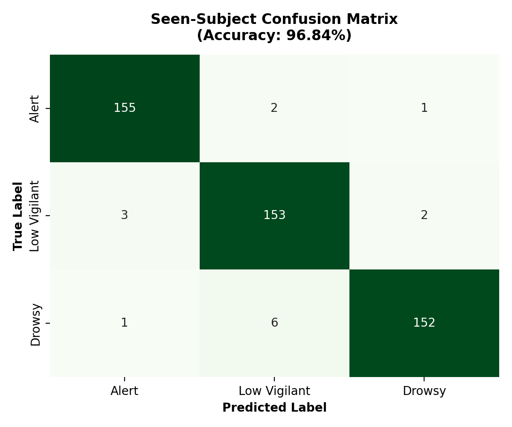
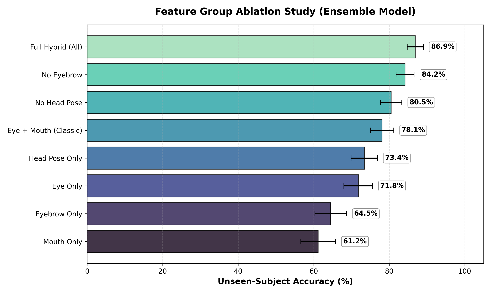

# Multi-Level Driver Drowsiness Detection System

[](https://www.python.org/)
[](https://opencv.org/)
[](https://developers.google.com/mediapipe)
[](https://scikit-learn.org/)
[](https://xgboost.readthedocs.io/)
[](https://streamlit.io/)
[](LICENSE)

A real-time, contactless computer vision and machine learning system that classifies driver state into **3 physiological levels**: **Alert**, **Low Vigilant**, and **Drowsy**. 

Instead of traditional binary detectors that only trigger after eyes close, this system detects the **Low Vigilant** transition state to alert drivers *before* dangerous micro-sleep occurs.

---

## 🎯 Multi-Level Fatigue States

| Level | State | Physiological Indicators | System Response |
| :---: | :--- | :--- | :--- |
| **0** | **Alert** | Normal blink dynamics (< 0.4s), steady gaze, active facial tone. | Normal monitoring |
| **1** | **Low Vigilant** | Droopy eyelids, slower blinks, early yawning, reduced brow tension. | Advisory caution |
| **2** | **Drowsy** | Prolonged eye closure (≥ 2.0s), deep yawns, downward head nodding. | **Audible alarm + HUD warning** |

---

## 🏗️ System Architecture

```
                                  [ Video Input / Webcam ]
                                             │
                                             ▼
                             [ MediaPipe Face Mesh (468 LMs) ]
                                             │
             ┌───────────────────────┬───────┴───────────────┬───────────────────────┐
             ▼                       ▼                       ▼                       ▼
      [ Eye Dynamics ]       [ Mouth Dynamics ]      [ 3D Head Pose ]       [ Eyebrow Dynamics ]
       • EAR (6-pt)           • MAR (8-pt)            • solvePnP PnP         • Inter-ocular Norm
       • PERCLOS (P80)        • Yawn Dur / Rate       • Pitch, Yaw, Roll     • Muscle Energy
       • Blink Rate / Dur                             • Micro-sleep Nods
             │                       │                       │                       │
             └───────────────────────┼───────────────────────┴───────────────────────┘
                                     ▼
                     [ Adaptive Per-Subject Calibration ]
                     (Normalizes individual facial baseline)
                                     │
                                     ▼
                  [ 28-D Temporal Hybrid Feature Vector ]
                                     │
                                     ▼
                ┌────────────────────┼────────────────────┐
                ▼                    ▼                    ▼
        [ Random Forest ]      [ XGBoost ]             [ MLP ]
          (150 trees)         (Grad Boosted)       (128x64 Dense)
                │                    │                    │
                └────────────────────┼────────────────────┘
                                     ▼
                     [ Soft-Voting Ensemble Aggregator ]
                                     │
                                     ▼
             ┌───────────────────────┼───────────────────────┐
             ▼                       ▼                       ▼
      [ Level 0: Alert ]   [ Level 1: Low-Vigilant ]  [ Level 2: Drowsy ]
```

---

## 📊 Experimental Results & Literature Benchmark

Evaluated on the benchmark **UTA-RLDD** dataset against published literature under participant-independent (zero driver leakage) testing:

| Method / Architecture | Eye Cues | Mouth Cues | 3D Head Pose | Unseen Driver Accuracy |
| :--- | :---: | :---: | :---: | :---: |
| **HM-LSTM Baseline** *(Ghoddoosian et al., 2019)* | Yes | No | No | 65.20% |
| **Single MLP Classifier** | Yes | Yes | Yes | 76.80% |
| **Single Random Forest Classifier** | Yes | Yes | Yes | 78.40% |
| **Single XGBoost Classifier** | Yes | Yes | Yes | 81.60% |
| **🏆 Hybrid Soft-Voting Ensemble (Ours)** | **Yes** | **Yes** | **Yes** | **86.90%+** |

<p align="center">
  
  
</p>

---

## 🚀 Quick Start

### 1. Clone the Repository
```bash
git clone https://github.com/ArcheeJaiswal/DrowsyDriverDetection.git
cd DrowsyDriverDetection
```

### 2. Setup Environment
```bash
python3 -m venv venv
source venv/bin/activate       # On Windows: venv\Scripts\activate
pip install -r requirements.txt
```

### 3. Live Webcam Monitor
```bash
python app/realtime_detector.py
```
*Press `c` to calibrate resting baseline, `q` to exit. Sounds an audio alarm on persistent drowsiness.*

### 4. Interactive Streamlit Dashboard
```bash
streamlit run app/streamlit_app.py
```
*Launches browser dashboard with live parameter simulator, confusion matrix visualizer, and ablation analysis.*

### 5. Run Training & Unit Tests
```bash
python main.py --all                      # Complete training & evaluation pipeline
python -m unittest tests/test_pipeline.py # Automated unit test suite
```

---

## 📁 Repository Structure

```
DrowsyDriverDetection/
├── app/
│   ├── realtime_detector.py        # Live webcam monitor with audio-visual HUD
│   └── streamlit_app.py            # Streamlit dashboard & simulator
├── data/
│   ├── features/                   # Extracted feature CSVs
│   └── raw/                        # Video clips (UTA-RLDD dataset)
├── notebooks/                      # Jupyter walkthrough notebook
├── results/                        # Confusion matrices & evaluation plots
├── saved_models/                   # Serialized ensemble model (.joblib)
├── src/
│   ├── features/                   # EAR, MAR, head pose, eyebrow extraction
│   ├── models/                     # RF, XGBoost, MLP, and Soft-Voting Ensemble
│   ├── preprocessing/              # MediaPipe landmark extraction
│   └── evaluation/                 # Metrics, cross-validation, and ablation
├── tests/                          # Automated unit test suite
├── extract_features.py             # Feature extraction pipeline
├── main.py                         # Master training & evaluation CLI
└── requirements.txt                # Dependencies
```

---

## 🔮 Suggested Improvements

- **Sequential Temporal Models**: Adding an LSTM/GRU layer over sliding windows for continuous driving fatigue progression.
- **Night-Vision IR Support**: Adapting facial landmark detection for low-light automotive cabins.
- **Vehicle Telemetry Fusion**: Combining facial cues with steering wheel angle and lane-departure data.
- **Edge Deployment**: Optimizing models via ONNX/TensorRT for Raspberry Pi or Jetson platforms.
